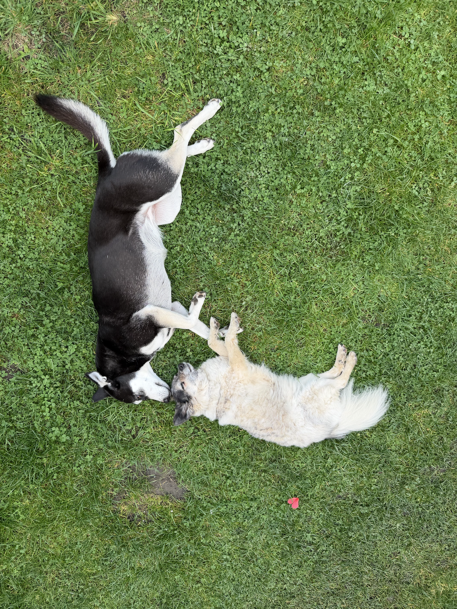

# Letterform L and Haiku

## The Letterform

## The Haiku

Two dogs rest in grass  
Their bodies bend into L  
Quiet, green, and warm  

## About this project

I found the letter L in two sleeping dogs. My Letterform is a photo, and the Haiku describes the moment it captures.

[How I made this Letterform](process.md)
