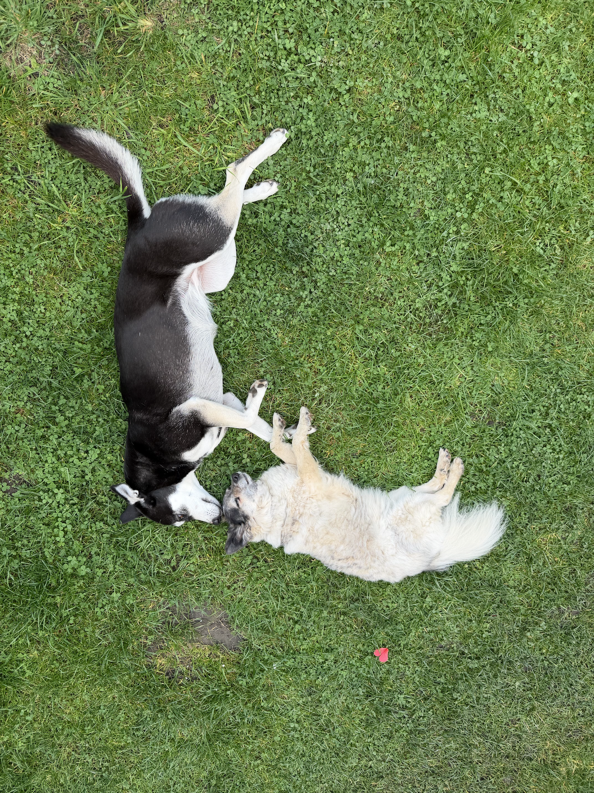

# How I Made This Letterform

## Process

1. I looked for a letter in everyday life instead of drawing one.
2. I noticed my two dogs lying together on the lawn.
3. I took a photo from above and saw that their bodies formed the letter L.
4. I chose this photo as my Letterform because it feels natural and calm.
5. I wrote the Haiku about the quiet moment in the photo.

## Early Haiku drafts

Draft 1  
Two dogs on the lawn  
Sleeping in the shape of L  
Sun on the green grass  

Draft 2  
Side by side they rest  
A black and a cream-white L  
Nothing else to do  

## Alternate alt text

**Focus on shape:** Seen from above, a black and white dog stretches in a straight vertical line while a fluffy cream dog lies across the bottom, making a right angle.

**Focus on mood:** Two sleeping dogs rest nose to nose on a sunny lawn. A tiny red petal lies in the grass nearby.

## References

- [An alt Decision Tree](https://www.w3.org/WAI/tutorials/images/decision-tree/) by W3C Web Accessibility Initiative

[The finished Letterform and Haiku](index.md)
